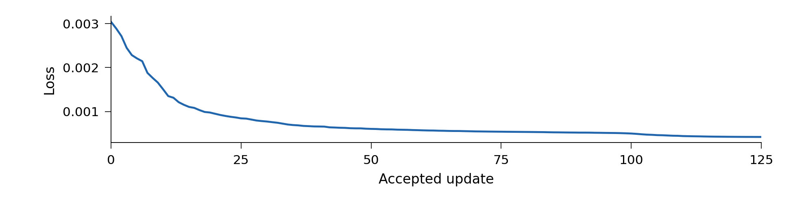

# DiffAxiSEM3D

**Authors** Xi Wang, Zhanwen Li, and Xin Liu (corresponding author)

Department of Earth and Planetary Sciences, The University of Hong Kong

We used SeismicDiffSkill to build DiffAxiSEM3D around the native AxiSEM3D
C++/MPI solver. You can run the salt inversion below or supply your own
waveform misfit. PyTorch differentiates the misfit with respect to the synthetic
receiver traces. The native solver applies the transpose of receiver sampling
to inject this data gradient as the adjoint source. DiffAxiSEM3D then computes
the Vp gradient from the forward and adjoint wavefields.
[Agent Skill](https://github.com/Wangxi404/differentiate-seismic-solver) ·
[Upstream AxiSEM3D](https://github.com/AxiSEMunity/AxiSEM3D)

## SEG/EAGE 3D salt inversion

This **float64, 3D isotropic elastic** example propagates P and S waves in a
lossless solid with absorbing boundaries disabled.
Each shot records radial, azimuthal and vertical displacement at 169 receivers.
The inversion evaluates all 9 shots at the same model and averages their
losses and model gradients before each update. We invert Vp on a 33 × 33 × 17
grid from a Gaussian-smoothed initial model, holding Vs and density fixed.
The optimizer constrains Vp to 1.45–4.70 km/s.

We chose debiased soft-DTW divergence as the default because its time-alignment
terms make the adjoint source difficult to derive by hand, and PyTorch lets you
switch to another differentiable misfit without deriving a new adjoint source.
For each shot, we divide each trace divergence by its processed sample count
and average over the 507 receiver-component traces. After 125 updates, the
mean loss over all shots (γ = 0.1) fell from **0.00304 to 0.000423**. The
inversion recovered the salt body's overall shape and part of its Vp contrast.


The true model is resampled from the SEG/EAGE 3-D Salt model (Aminzadeh,
Brac & Kunz, 1997). We smoothed it to form the initial model. Source model
© 1997 Society of Exploration Geophysicists.
[SEG dataset](https://wiki.seg.org/wiki/SEG/EAGE_Salt_and_Overthrust_Models) ·
[CC BY 4.0](https://creativecommons.org/licenses/by/4.0/) ·
[Original data notice](examples/salt/DATA_ATTRIBUTION.txt)



## Run the example

Run from the repository root. These commands target Ubuntu 24.04 and Python 3.12.

```bash
sudo apt-get install build-essential cmake git patch openmpi-bin libopenmpi-dev \
    libeigen3-dev libboost-dev libfftw3-dev libmetis-dev libnetcdf-dev python3-venv
python3 -m venv .venv
source .venv/bin/activate
python -m pip install torch==2.6.0 --index-url https://download.pytorch.org/whl/cpu
python -m pip install -r requirements.txt
bash native/build.sh
python -m diffaxisem3d.invert --workers 4 --ranks 2
```

The example generates synthetic observations and writes **`runs/salt/model-recovery.html`**
after 125 updates. Four workers use eight MPI processes and about 20 GiB of
scratch space. Use `--workers 1` on smaller machines. For a quick check,
run with `--iterations 1`, then use `--resume` to continue to 125.

For another misfit, pass `--misfit my_module:loss`. The function takes
`(predicted, observed, dt, observed_rms)`. Return one `torch.float64` scalar
loss for a single shot, differentiable with respect to `predicted`. Trace
tensors have shape `(time, receiver, component)`. Apply any within-shot
weighting or averaging in your function. The solver handles the mean over shots.
[Objective implementation](diffaxisem3d/objective.py) ·
[Code license](LICENSE)
