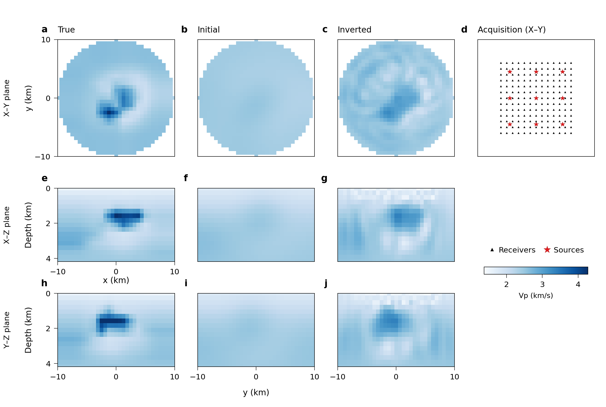

# DiffAxiSEM3D-native

This example uses SeismicDiffSkill to connect native AxiSEM3D propagation to
differentiable waveform misfits. PyTorch differentiates the misfit with respect
to receiver traces to form the adjoint source. Forward and adjoint waves
propagate in C++ with MPI to compute the Vp gradient.
[Upstream AxiSEM3D](https://github.com/AxiSEMunity/AxiSEM3D)

## SEG/EAGE 3D salt inversion

This **float64, 3D isotropic elastic** simulation propagates P and S waves.
Each update uses all 9 shots at the same model, with radial, azimuthal and
vertical displacement recorded at 169 receivers. We invert Vp on a 33 × 33 × 17
grid from a Gaussian-smoothed initial model, holding Vs and density fixed.

After 125 updates, the **debiased soft-DTW divergence** (float64, γ = 0.1)
fell from **0.00304 to 0.000423**. Vp RMSE within the simulated cylinder
fell from **201 to 166 m/s**.




## Run the example

Run from the repository root. These commands target Ubuntu 24.04 and Python 3.12.

```bash
sudo apt-get install build-essential cmake git patch openmpi-bin libopenmpi-dev \
    libeigen3-dev libboost-dev libfftw3-dev libmetis-dev libnetcdf-dev python3-venv
python3 -m venv .venv
source .venv/bin/activate
python -m pip install torch==2.6.0 --index-url https://download.pytorch.org/whl/cpu
python -m pip install -r requirements.txt
bash native/build.sh
python -m diffaxisem3d.invert --workers 4 --ranks 2
```

The example generates synthetic observations and writes **`runs/salt/model-recovery.html`**
after 125 updates. Four workers use eight MPI processes and about 20 GiB of
scratch space. Use `--workers 1` on smaller machines. For a quick check,
run with `--iterations 1`, then use `--resume` to continue to 125.

For another misfit, pass `--misfit my_module:loss`. The function takes
`(predicted, observed, dt, observed_rms)` and returns one scalar PyTorch loss
per shot. Trace tensors have shape `(time, receiver, component)`.
[Objective implementation](diffaxisem3d/objective.py)

Salt model adapted from Aminzadeh, Brac and Kunz (1997), *SEG/EAGE 3-D Salt
and Overthrust Models*. [Data attribution](examples/salt/DATA_ATTRIBUTION.txt) ·
[Code license](LICENSE)
